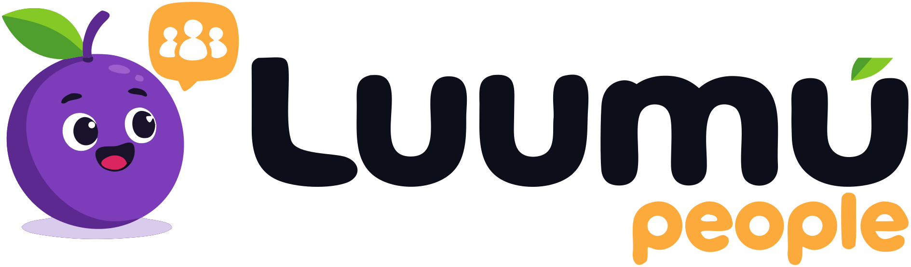
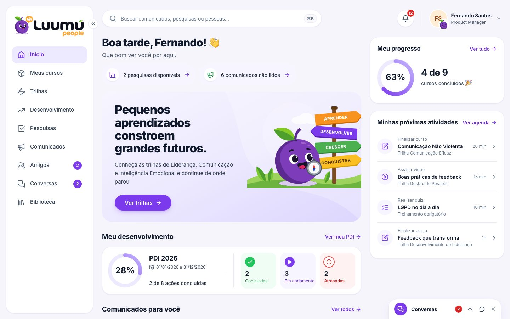
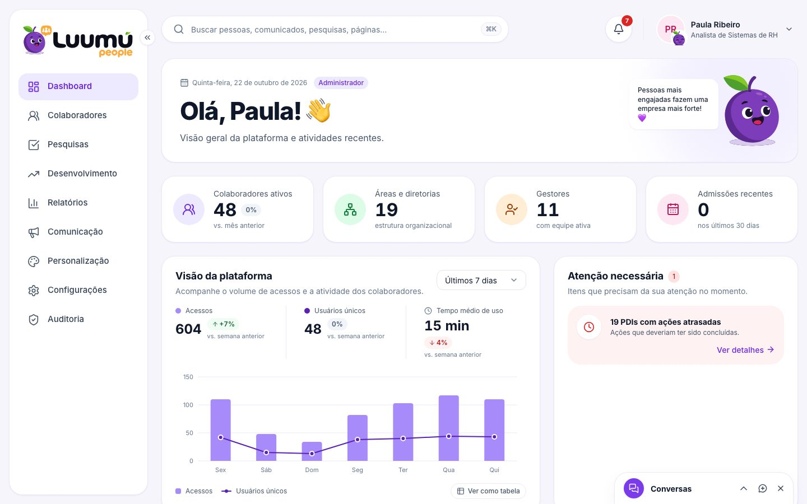

<p align="center">
  
</p>

<p align="center">
  Plataforma de experiência, desenvolvimento e inteligência de pessoas:<br>
  comunicação interna, educação corporativa, desenvolvimento, pesquisas com anonimato real e indicadores de G&G.
</p>

|  |  |
|---|---|
| **Colaborador** — o dia da pessoa num só lugar | **Gestão** — pessoas, uso e alertas, no escopo de quem vê |

Mais telas no [tour visual](docs/product.md#tour-visual).

## Estado

| Fase ([roadmap](docs/rfc/0001-arquitetura.md#13-roadmap-e-definition-of-done)) | Situação |
|---|---|
| 1 — Foundation | ✅ entregue: auth, multi-tenancy com RLS, RBAC com escopo, auditoria, feature flags, arquivos, design system |
| 2 — Experiência do colaborador | 🟡 início, comunicados, perfil, notificações e busca no ar; cursos e trilhas atrás da flag `module_learning`; biblioteca e conquistas a seguir |
| 3 — Desenvolvimento | ✅ competências, PDI com mentoria, visão do gestor, relatórios |
| 4 — Pesquisas | ✅ builder, cofre anônimo, k-anonimato, público e agendamento, resultados agregados |
| 5 — Admin | 🟡 colaboradores e auditoria no ar; conteúdos, personalização e configurações a seguir |
| Além do roadmap | ✅ conexões, amigos e conversas (chat) |

Detalhe por módulo e rota em [docs/product.md](docs/product.md#módulos-e-estado).

## Começando (sem instalar banco)

```bash
pnpm install
cp .env.example .env.local
# gere o segredo e cole em BETTER_AUTH_SECRET:
openssl rand -base64 48
pnpm dev
```

Abra http://localhost:3000. O banco local é um Postgres embarcado (PGlite, em `.data/pglite`) que se migra e se popula sozinho com dados **fictícios**. Senha de todas as contas demonstrativas: `Luumu@Demo2026`.

| Conta | Papel | O que dá para ver |
|---|---|---|
| `fernando.santos@aurora.example` | Colaborador | Experiência do colaborador |
| `carla.mendes@aurora.example` | Gestora (Produto) | Gestão limitada à própria equipe |
| `rafael.lima@aurora.example` | Editor | Gestão de conteúdo, sem dados de pessoas |
| `juliana.mendes@aurora.example` | G&G / People | Pessoas e indicadores da empresa |
| `paula.ribeiro@aurora.example` | Administradora | Tudo, incluindo papéis e auditoria |
| `sergio.tavares@horizonte.example` | Admin de **outra empresa** | Isolamento entre tenants |

Para recomeçar do zero: `pnpm db:reset-local`.

## Documentação

Índice completo, com roteiros de leitura por perfil: **[docs/README.md](docs/README.md)**.

| Tema | Documentos |
|---|---|
| **Produto** | [Visão, módulos e tour visual](docs/product.md) |
| **Design** | [Design system: marca, tokens, componentes, padrões de tela](docs/design-system.md) · [arquivos-fonte da marca](brand/README.md) · vitrine em `/design-system` |
| **Arquitetura** | [Arquitetura](docs/architecture.md) · [API](docs/api.md) · [RFC 0001](docs/rfc/0001-arquitetura.md) |
| **Dados** | [Modelagem de dados (diagramas ER)](docs/data-model.md) · [Banco de dados: RLS, roles, migrations](docs/database.md) |
| **Segurança** | [Segurança](docs/security.md) · [RBAC](docs/rbac.md) · [Pesquisas anônimas](docs/anonymous-surveys.md) |
| **Operação** | [Ambiente](docs/environment.md) · [Deploy (Vercel + Neon)](docs/deployment.md) · [Scripts](docs/scripts.md) · [Testes](docs/testing.md) |

## Stack

Next.js 16 (App Router, Cache Components) · React 19 · TypeScript · Tailwind CSS 4 · Radix · PostgreSQL 17 (Neon; PGlite local) · Drizzle · Better Auth · Zod · Vitest · Playwright + axe · Vercel (Blob, Functions).

## Estrutura

```
src/app/            rotas: (auth), (colaborador), gestao, api/v1
src/design-system/  componentes e ilustrações (tokens em src/app/globals.css)
src/features/       UI por domínio
src/server/         só servidor: auth, authz, db, http, modules/<domínio>
db/migrations/      SQL versionado, com migrations de segurança (RLS, policies, grants)
brand/              arquivos-fonte da marca
public/             arquivos servidos
scripts/            CLI de operação
tests/              unit, integration, e2e, screenshots
docs/               documentação
```

Detalhes e regras de dependência em [docs/architecture.md](docs/architecture.md#estrutura-de-pastas).

## Comandos

| Comando | O que faz |
|---|---|
| `pnpm dev` | Servidor de desenvolvimento |
| `pnpm check` | Lint + tipos + testes (rode antes de abrir PR) |
| `pnpm test` | Testes unitários, de integração e de segurança (Postgres real via PGlite) |
| `pnpm test:e2e` | E2E + acessibilidade (Playwright + axe). Não rode com `pnpm dev` aberto |
| `pnpm db:generate` | Gera migration a partir do schema |
| `pnpm db:migrate` | Aplica migrations no Neon (`DATABASE_URL_MIGRATIONS`) |
| `pnpm db:seed` | Dados demonstrativos no Neon (dev/preview) |
| `pnpm db:provision-roles` | Cria os logins de runtime no Neon |
| `pnpm tenant:create` | Cria uma empresa real e o primeiro administrador |
| `pnpm org:import <arquivo.json>` | Importa áreas, cargos, níveis e pessoas de uma empresa |
| `pnpm content:seed --tenant <slug>` | Carrega o conteúdo de exemplo (comunicados, trilhas, biblioteca, conquistas) |
| `pnpm brand:build` | Regenera as variações da marca a partir do SVG oficial |
| `pnpm docs:screenshots` | Atualiza as capturas de tela da documentação |

Backup, limpezas, planilha de organograma e e-mail de teste: [docs/scripts.md](docs/scripts.md).

## Prioridades do projeto

Segurança → privacidade → anonimato → integridade dos dados → autorização → arquitetura → UX → performance → escalabilidade → estética. Nenhuma conveniência de implementação justifica inverter essa ordem.
