# Modelagem de dados

Entidades e relacionamentos da Luumu People, por domínio, lidos de `src/server/db/schema/*.ts` e do schema `survey_vault` (migrations de segurança). Este documento descreve o **modelo conceitual**: o que existe, como se liga e quais invariantes valem.

Os detalhes físicos (convenções de nomes, roles de banco, RLS, grants, migrations, seed) estão em [database.md](database.md). O cofre de respostas anônimas tem contrato próprio em [anonymous-surveys.md](anonymous-surveys.md), e papéis, permissões e escopos estão em [rbac.md](rbac.md).

**Leitura dos diagramas**

- Quase toda tabela tem `tenant_id NOT NULL` e as FKs entre tabelas de empresa são **compostas** `(tenant_id, id)`. Para não poluir, `tenant_id` só aparece em `organizations`, e as FKs aparecem como a coluna de negócio (`user_id`, `course_id`…).
- `created_at`/`updated_at` existem na maioria das tabelas e foram omitidos, salvo quando têm significado de negócio.
- Só aparecem colunas-chave: PK, FKs e campos que carregam regra. O schema Drizzle é a fonte da verdade para o resto.
- `users` aparece em vários diagramas apenas como ponto de ligação. Os atributos dela estão em [Identidade](#identidade-e-autenticação).

## Mapa de domínios

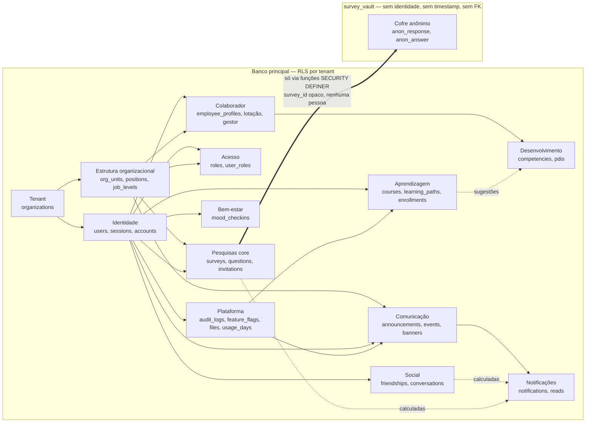

O cofre não referencia `users`, `survey_invitations` nem nada que identifique uma pessoa. A única ponte é o `survey_id` (e o `question_id`) gravados como `uuid` solto, sem FK, e só as funções `survey_vault.*` atravessam essa fronteira.

## Tenant

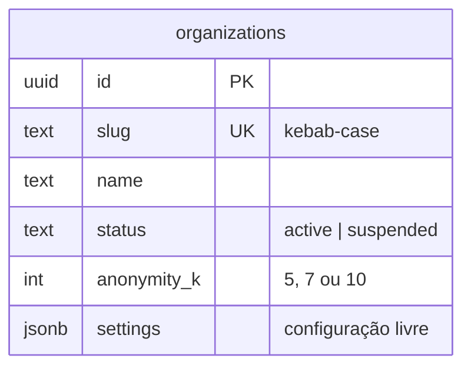

- Toda informação de uma empresa pertence a exatamente uma `organization`.
- `anonymity_k ∈ {5, 7, 10}` (CHECK) é o piso de k-anonimato da empresa: nenhuma pesquisa é lançada com k menor.
- `settings` é o único JSON de configuração do tenant (ranking de conquistas, ociosidade de sessão). Nunca guarda relacionamentos.

## Identidade e autenticação

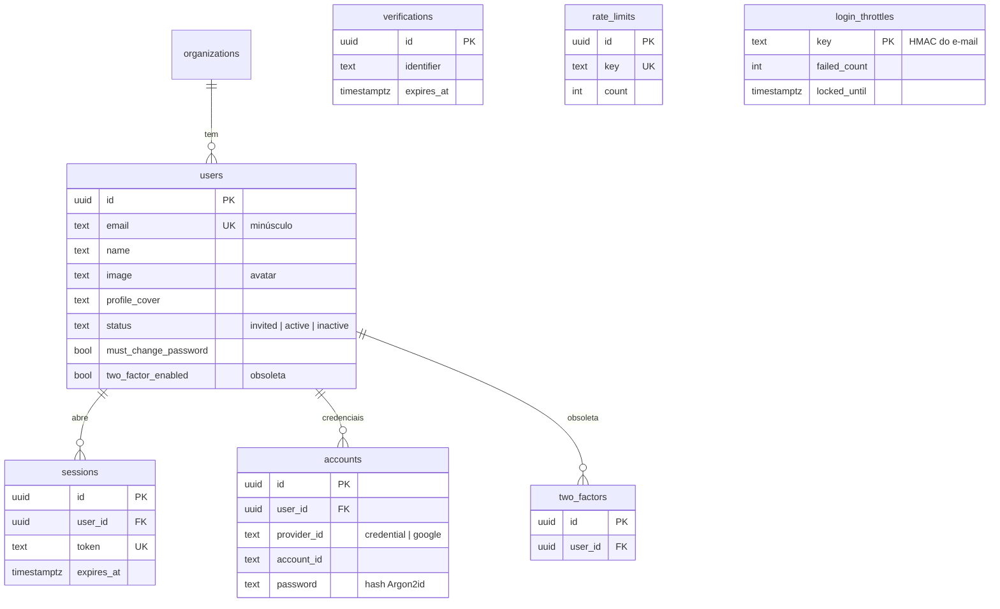

- `users` é **só identidade de login** (contrato do Better Auth). Dados de RH ficam em `employee_profiles`, que o Better Auth não enxerga.
- E-mail é único na plataforma e sempre minúsculo (CHECK).
- `must_change_password`: pessoa importada com senha provisória só usa a plataforma depois de criar a própria senha.
- `login_throttles` bloqueia por conta sem guardar o e-mail: a chave é um HMAC do e-mail normalizado. `rate_limits` é o rate limit por IP do Better Auth (serverless não compartilha memória).
- `verifications` guarda tokens de redefinição de senha e afins.

## Estrutura organizacional e colaborador

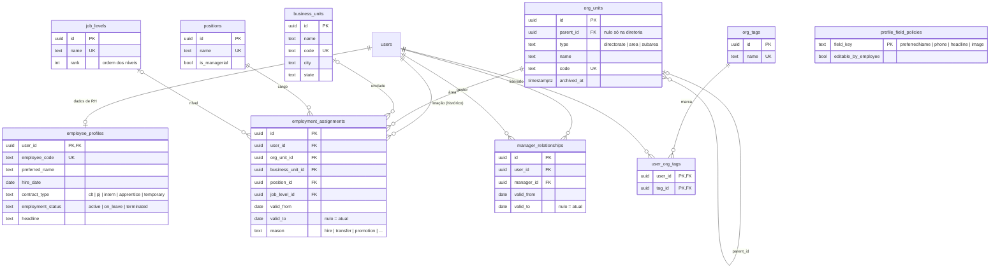

- **Hierarquia:** diretoria → área → subárea em `org_units`. A raiz é sempre `directorate` e só ela não tem pai (CHECK); ninguém é pai de si mesmo. `business_units` (localidade/filial) é ortogonal à hierarquia.
- **Vigência, nunca sobrescrita:** lotação e gestor fecham o registro atual (`valid_to`) e abrem outro. Índice único parcial garante **uma** lotação e **um** gestor atuais por pessoa (`valid_to IS NULL`); `valid_to > valid_from`. Sem `DELETE` para o runtime.
- Ninguém é gestor de si mesmo (CHECK).
- `employee_profiles` é 1:1 com `users`; uma pessoa convidada pode ainda não ter perfil de RH.
- `profile_field_policies` define, por empresa, quais campos a própria pessoa pode editar.
- Arquivamento (`archived_at`) em vez de exclusão para áreas, unidades e cargos.

## Acesso (RBAC)

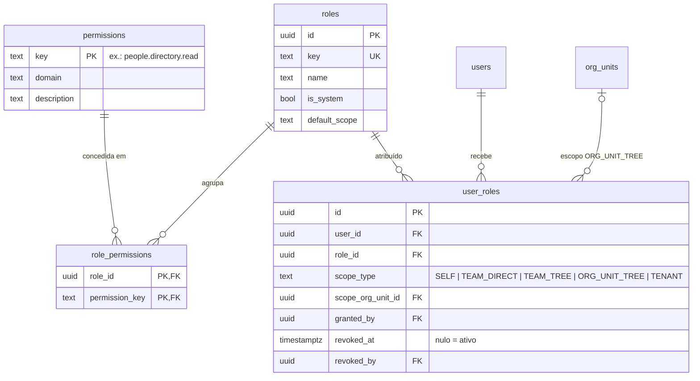

- `permissions` é **global** e espelha o catálogo em código (`src/server/authz/permissions.ts`), sincronizado por `syncCatalog()`. `roles` é por empresa; os papéis de sistema têm `is_system`.
- A atribuição carrega o **escopo**. `scope_org_unit_id` é preenchido se, e somente se, o escopo é `ORG_UNIT_TREE` (CHECK).
- Ninguém concede papel a si mesmo (`granted_by <> user_id`, CHECK).
- Revogar preenche `revoked_at`/`revoked_by`: o histórico de acesso nunca é apagado. Índice único parcial impede a mesma atribuição ativa em duplicidade.

## Plataforma

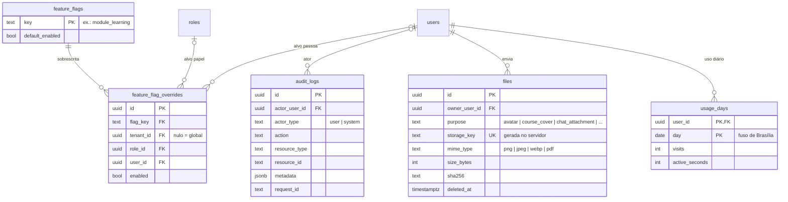

- `audit_logs` é **append-only**: só `INSERT`/`SELECT` para o runtime e um trigger rejeita `UPDATE`/`DELETE`/`TRUNCATE`. Nunca registra nada que associe pessoa a resposta anônima.
- Feature flags: precedência pessoa > papel > empresa > global > padrão. Cada sobrescrita tem no máximo um alvo (papel **ou** pessoa) e alvo exige empresa (CHECKs); índice único por combinação.
- `files` é o registro de todo upload. O conteúdo fica em storage **privado**; o acesso é sempre por `/api/v1/files/:id`. `purpose` diz quem pode referenciar o arquivo (capa de curso, anexo de conversa…). MIME restrito por CHECK.
- `usage_days`: uma linha por pessoa e dia, alimentada pelo sinal de presença. Cada pessoa grava só a própria linha; os painéis leem apenas agregados.
- Fora do diagrama: o schema interno `app` guarda funções de apoio (`current_tenant_id`, `current_user_id`, `chat_*`) e o rate limit da API (`rate_limit_buckets`), sem acesso direto pelo runtime.

## Comunicação

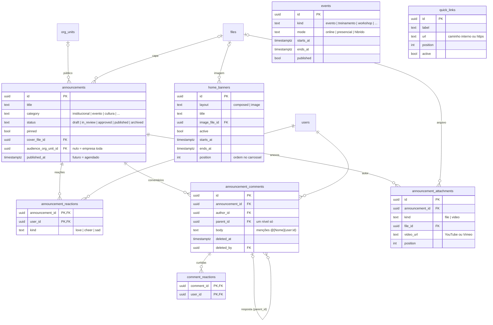

- **Público:** `audience_org_unit_id` nulo = empresa toda; com área, só quem tem lotação atual nela ou em subárea vê o comunicado e interage com ele (regra em `modules/announcements/audience.ts`).
- **Publicado** exige `published_at` (CHECK). Agendar = `published` com data futura; o mural só mostra `published_at <= now()`.
- Uma reação por pessoa e comunicado (PK composta); trocar de reação atualiza `kind`.
- Comentário removido = `deleted_at` + `deleted_by` (sempre juntos, CHECK), nunca apagado. Respostas têm um nível só.
- Curtir, reagir e comentar só em nome próprio, garantido também por policies `RESTRICTIVE`.
- Anexo é arquivo **ou** vídeo, nunca os dois (CHECK). URLs externas são sempre `https://`; links internos começam com `/`.
- Banner `image` exige imagem e não tem botão; banner `composed` tem botão completo (rótulo + URL) ou nenhum (CHECKs). Vários ativos viram carrossel.

## Aprendizagem

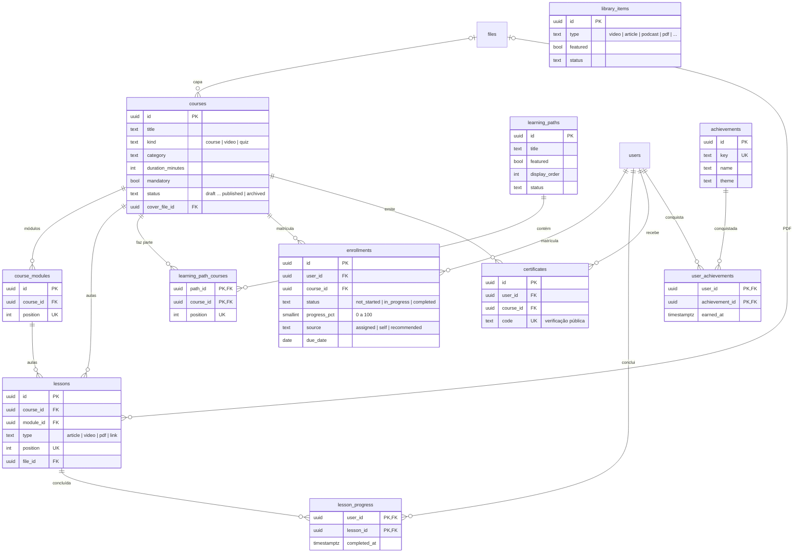

- Conteúdo segue o ciclo editorial `draft → in_review → approved → published → archived`. Sem capa enviada, a capa é `theme` + `illustration` do design system.
- Ordem explícita e única por `position` (módulos e aulas no curso, cursos na trilha).
- Conteúdo da aula conforme o tipo (CHECK): `article` → `body`; `video` → `video_url`; `pdf` → `file_id`; `link` → `external_url` `https://`.
- Uma matrícula e um certificado por pessoa e curso. `status` e `progress_pct` são coerentes por CHECK (`completed` ⇔ 100; `not_started` ⇒ 0).
- `lesson_progress` é a fonte do progresso (ver [derivados](#o-que-é-derivado-não-gravado)).
- Cursos, trilhas e biblioteca ficam atrás das feature flags `module_learning` e `module_library`.

## Desenvolvimento

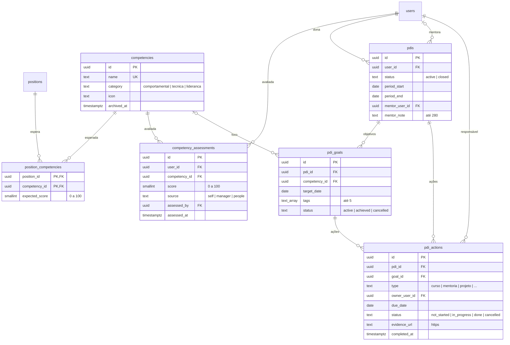

- **Nível esperado** por cargo e competência (`position_competencies`, 0–100) é a referência contra a qual as avaliações são comparadas.
- `competency_assessments` é **append-only** (runtime só tem `SELECT`/`INSERT`): o histórico alimenta a evolução e nunca é editado.
- No máximo **um PDI ativo** por pessoa (índice único parcial). A mentoria nunca é a própria pessoa (CHECK). `period_end >= period_start`.
- Ação concluída ⇔ `completed_at` preenchido (CHECK); evidência só por link `https://`.

## Social: amigos e conversas

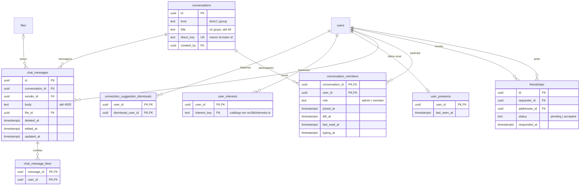

- **Um vínculo por par** de pessoas, independentemente de quem pediu (índice único em `least/greatest`). `accepted` ⇔ `responded_at` (CHECK). Recusar, cancelar e desfazer apagam a linha.
- Conversa `direct` tem `direct_key` único e não tem nome; `group` tem nome e não tem chave (CHECK). Uma conversa privada por par.
- Quem entra num grupo só lê mensagens a partir de `joined_at`; `left_at` corta o acesso. Nem gestão nem administração leem conversas.
- Mensagem tem texto ou anexo; apagada fica com texto vazio e sem anexo (CHECK). Edição só do texto, com `edited_at` posto pelo banco. Sem `DELETE` para o runtime em conversas, participantes e mensagens.
- Pedidos pendentes são vistos só pelas duas pessoas; amizades aceitas, interesses e presença são visíveis na empresa. Sugestões dispensadas são estritamente pessoais.

## Bem-estar

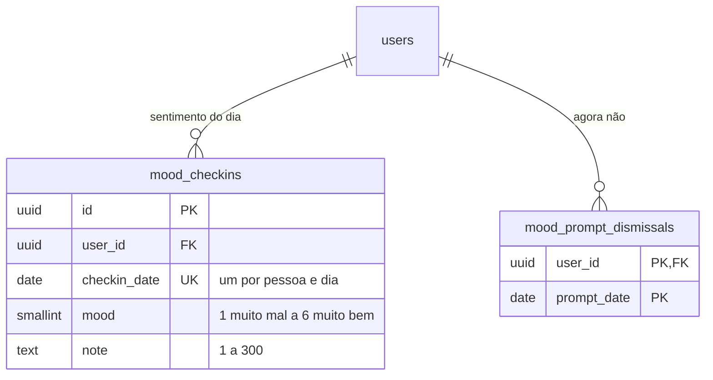

- O check-in de humor é **identificado** e, por decisão de produto, visível para a empresa no dia (o modal avisa). Gravar e alterar, só a própria linha (policy `RESTRICTIVE`).
- `mood_prompt_dismissals` evita reabrir o modal no mesmo dia e é estritamente pessoal.

## Notificações

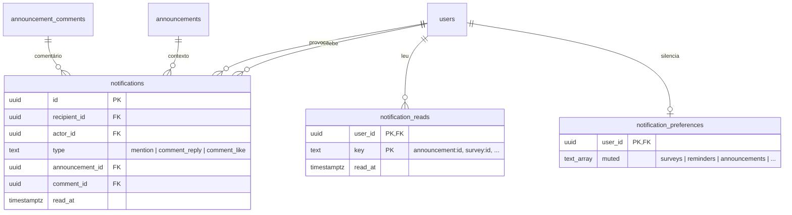

- **Gravadas** (`notifications`): interações entre pessoas, uma linha por destinatário. Nunca para si mesmo (CHECK) e idempotentes (único por destinatário, tipo, comentário e ator).
- **Calculadas** na leitura (novo comunicado, nova pesquisa, lembrete, pedido de amizade e amizade aceita): vêm das tabelas de origem e só a leitura é gravada, em `notification_reads`, pela chave `<tipo>:<uuid>`.
- Nenhuma notificação envolve resposta de pesquisa: as de pesquisa usam só o convite da própria pessoa.

## Pesquisas (core)

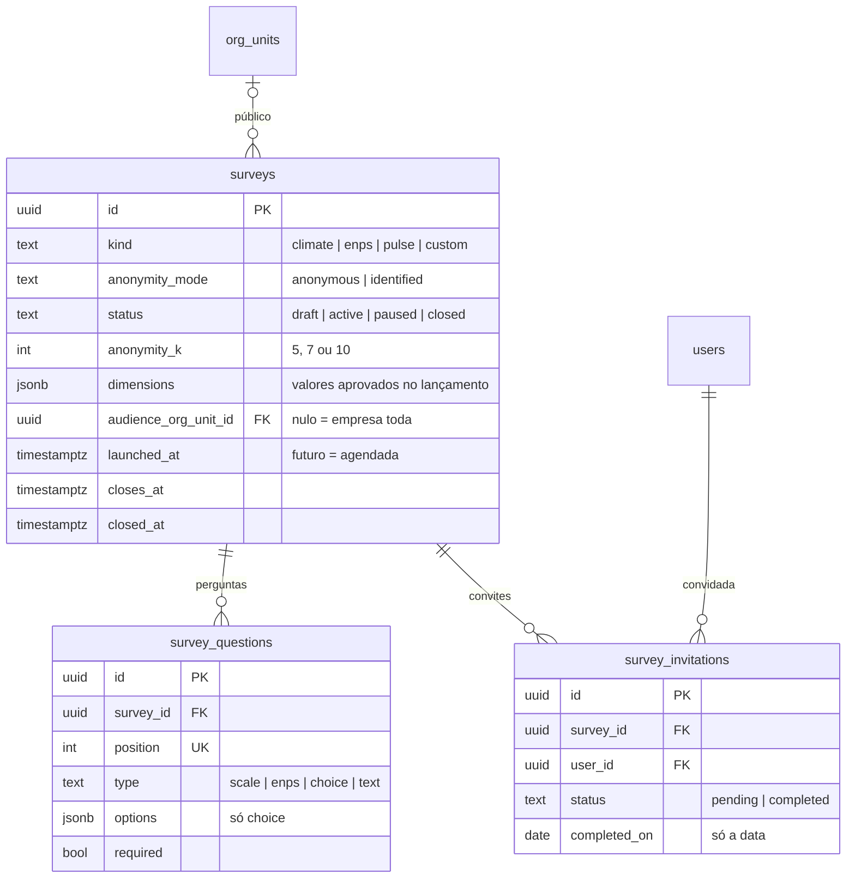

- A pesquisa é a própria campanha (uma aplicação por pesquisa).
- **Ciclo** (trigger): `draft → active ⇄ paused → closed` (e `active → closed`). Pausada não recebe respostas. Lançada exige `launched_at` e `closes_at`; encerrada exige `closed_at` (CHECKs).
- **Congela no lançamento** (trigger): `anonymity_mode`, perguntas, `dimensions` e público. O k nunca é menor que o da empresa e, depois de lançado, só sobe.
- Só rascunho é excluído pelo runtime; pesquisa lançada só sai por `survey_vault.purge`, que leva junto as respostas do cofre.
- `survey_invitations` registra **participação**, nunca resposta: só `status` e a **data** de conclusão, sem timestamps, para não permitir correlação com o cofre.

## Cofre anônimo (`survey_vault`)

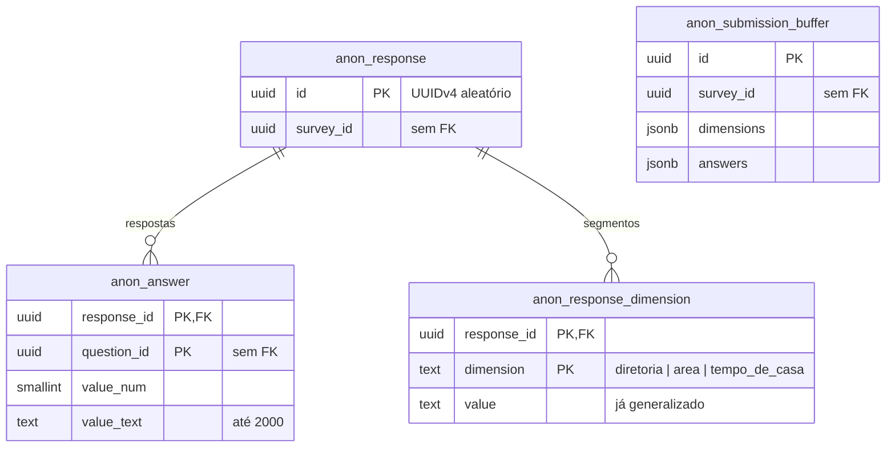

- Sem identidade, sem timestamp e sem FK para o core. As dimensões chegam **já generalizadas**; valores com menos de k convidados viram "Outros".
- Envio entra no `anon_submission_buffer` e é movido em lote, em ordem aleatória, para as tabelas finais (`_flush`), para que a ordem de gravação não revele quem respondeu.
- Cada resposta tem exatamente um valor: numérico **ou** texto (CHECK).
- Nenhuma role de runtime tem grant nas tabelas. O acesso é só por `EXECUTE` em `submit`, `close`, `results`, `breakdown` e `purge` (`SECURITY DEFINER`), e a leitura devolve agregados suprimidos abaixo de k. Detalhes e ameaças em [anonymous-surveys.md](anonymous-surveys.md).

## O que é derivado, não gravado

| Informação | Como é obtida |
|---|---|
| Ação de PDI "atrasada" | prazo vencido (`due_date < hoje`, fuso de Brasília) e status `not_started`/`in_progress` |
| Evolução do PDI, variação das competências | lidas do histórico de `competency_assessments` e das ações |
| Conquistas de desenvolvimento | cada nível de proficiência inédito numa competência, calculado sobre as avaliações |
| Sugestões de conteúdo no desenvolvimento | cursos e trilhas publicados cuja categoria ou título cita uma competência ainda abaixo do esperado, excluindo o que a pessoa já concluiu |
| Progresso da matrícula | calculado de `lesson_progress` a cada aula concluída e materializado em `enrollments.progress_pct`/`status`; ao chegar a 100% é emitido o certificado |
| Notificações de comunicado, pesquisa, lembrete e amizade | calculadas na leitura a partir das tabelas de origem; só a leitura é gravada |
| Lotação e gestor "atuais" | o registro com `valid_to` nulo |
| Público de comunicado e pesquisa | lotação atual na área ou em subárea dela |
| "Online agora" | `user_presence.last_seen_at` recente |
| Resultados de pesquisa | agregados calculados pelo cofre na hora, com supressão abaixo de k |

## Dívidas de modelo

Remoções seguem expand/contract: a coluna ou tabela sai numa migration da **release seguinte**, depois que a versão que deixou de usá-la estiver no ar.

| Item | Situação |
|---|---|
| `two_factors` | 2FA descartado do produto. Sem uso no código |
| `users.two_factor_enabled` | idem |
| `user_follows` | "Seguir" virou o próprio pedido de conexão (out/2026). Sem uso no código |
| `notification_reads.key` aceita o prefixo `follow:` | resto do "seguir"; sai junto com `user_follows` |
| `user_org_tags` | modelada e semeada (`org_tags`), mas ainda sem leitura ou escrita na aplicação |
